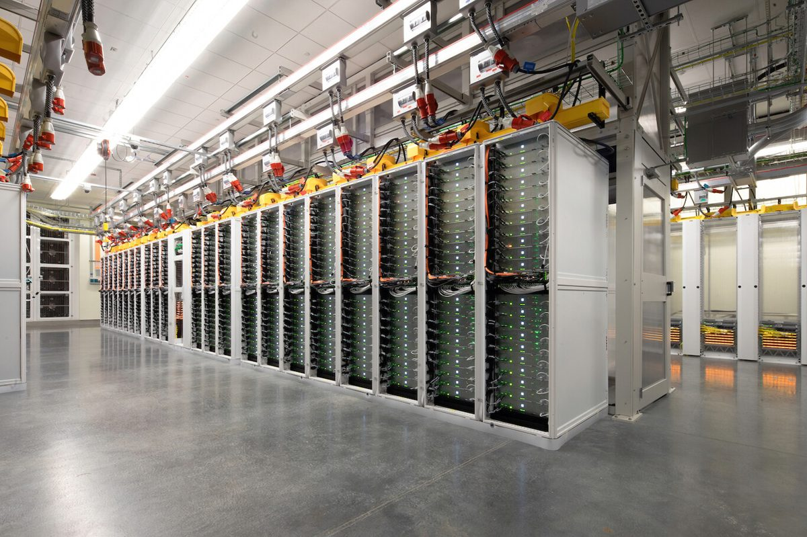

# Fonaments de la IA i evolució

## Què és la intel·ligència artificial?

-   **Intel·ligència**

    ---

    Capacitat d'aprendre, comprendre i resoldre problemes.

-   **Intel·ligència artificial**

    ---

    Intel·ligència exhibida per màquines.

-   **Màquina intel·ligent**

    ---

    Sistema que pot percebre el seu entorn i prendre accions que maximitzen les seves possibilitats d'èxit en un objectiu.

<figure>
  <video src="../img/bender.mp4" poster="../img/bender.jpg" width="360" autoplay loop muted playsinline></video>
  <figcaption>Tenim ja una màquina intel·ligent?</figcaption>
</figure>

## Intel·ligència humana

És una **capacitat molt complexa**, adquirida a partir de milions d'anys d'**evolució**.

Alguns dels **aspectes de la intel·ligència humana** són aprendre, resoldre problemes, adaptar-se a nous entorns, prendre decisions, comunicar-se i socialitzar o sentir emocions.

Encara sabem molt poc sobre com funciona. **Turing** deia que la intel·ligència era el resultat de la interacció entre molts processos simples. A partir d'aquesta idea s'han dissenyat gran part dels algorismes que fan servir les nostres màquines avui dia.

## Intel·ligència computacional

La intel·ligència artificial intenta **entendre i modelar la intel·ligència humana** com a un procés **computacional**.

Intentem modelar programes que s'aproximin al que definim com a intel·ligència, per tal de fer-nos la vida més fàcil.

La IA és part de la **ciència de la computació**.

{ loading=lazy }

### Intel·ligència computacional vs. intel·ligència humana

| Intel·ligència humana | Intel·ligència computacional |
|---|---|
| Biològica | Computacional |
| General | Específica |
| Conscient | Inconscient |
| Emocional | Racional |
| Adaptativa | Estàtica |
| Evolutiva | Dissenyada |

## Tipus d'intel·ligència artificial

=== "IA feble (dèbil)"

    Feta per a **una sola cosa**. Funciona molt bé en el seu camp. No té consciència ni ment pròpia.

    *Exemples:* assistents de veu (Siri, Alexa), filtres de correu brossa i cotxes autònoms.

=== "IA forta"

    Buscaria **imitar completament la ment humana**. Podria aprendre i resoldre qualsevol problema nou. Tindria capacitat d'adaptació i pensament propi.

    Actualment és **només un objectiu teòric**.

## Què és la racionalitat?

La **raó** o **racionalitat** és una aptitud que consisteix a aplicar normes i lògica en el pensament per obtenir judicis, observacions comprovables o servir de base per a teories.

El **pensament racional** permet l'abstracció, l'associació d'idees, l'autoconsciència i els símbols, coses que no tenen animals com ara els insectes o la gran majoria de peixos i rèptils, més lligats a l'instint i a una resposta unívoca al medi (per això es diu que són irracionals).

La raó, doncs, també està lligada a **la capacitat per decidir entre diverses alternatives** de conducta.

## Paradigmes de la IA

Són els grans models, enfocaments i filosofies de pensament sobre com crear sistemes intel·ligents.

Abasten des de la lògica formal basada en regles humanes fins a models autònoms d'aprenentatge massiu i sistemes orientats a l'acció.

### Paradigma simbòlic

- S'escriuen regles de tipus **if-then** per emular el raonament humà.
- Útil en medicina o dret per prendre decisions basades en dades estructurades.
- **Limitació:** rigidesa davant del món real i dificultat per gestionar la indeterminació o el context complex.

### Paradigma connexionista

- Capes de **nodes interconnectats** que detecten patrons complexos sense regles humanes prèvies.
- El sistema millora amb l'experiència i l'ús massiu d'informació.
- Base de la visió per computador, el reconeixement de veu i els models actuals.

### Paradigma generatiu

- Processen i combinen de manera simultània veu, imatges i text.
- Generen respostes fluides i naturals a partir de models predictius de llenguatge.

### Paradigma agèntic

- L'agent defineix subtasques, utilitza eines i resol problemes de principi a fi.
- Equips de diferents IA coordinades es reparteixen rols de treball sense intervenció humana constant.

> [!TIP]
> El paradigma agèntic és la base del **Projecte 2** (orquestració d'agents amb OpenClaw), i el generatiu, dels projectes 3 a 5 (LLMs locals, bases de dades vectorials i anàlisi de logs).

## Aplicacions de la IA

<figure>
  <video src="../img/aplicacions.mp4" poster="../img/aplicacions.jpg" width="420" autoplay loop muted playsinline></video>
</figure>

### Robòtica

- La robòtica és una de les aplicacions més conegudes de la IA.
- Un robot és un sistema capaç d'interactuar amb el seu entorn.
- Els robots poden ser **autònoms** o **teleoperats**.
- *Camps d'aplicació:* indústria, sanitat, exploració espacial, militar, domèstic, etc.

### Processament del llenguatge natural

- Capacitat d'un ordinador per entendre el llenguatge humà.
- Els humans utilitzem el llenguatge per comunicar-nos i per transmetre coneixement.
- *Camps d'aplicació:* traducció automàtica, reconeixement de veu, resum de textos, chatbots, etc.

### Visió per computador

- Capacitat d'un ordinador per entendre imatges.
- Els humans utilitzem la visió per entendre el món que ens envolta: identificar objectes, persones, colors, etc.
- *Camps d'aplicació:* reconeixement facial, reconeixement d'objectes, reconstrucció 3D, etc.

### Altres aplicacions

| Àmbit | Exemples |
|---|---|
| Sistemes de recomanació | Productes, música… |
| Jocs | Cartes, tauler, rol… |
| Medicina | Diagnòstic, cirurgia, medicina personalitzada… |
| Enginyeria | Disseny, control de processos… |
| Finances | Predicció de mercats, recomanació d'inversions… |
