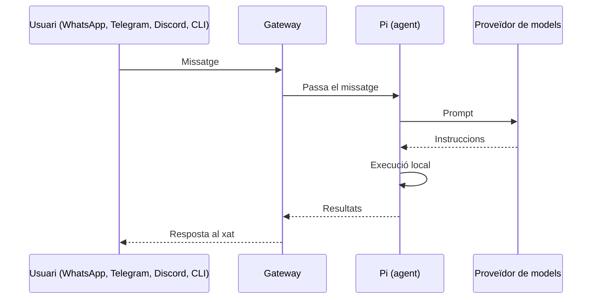
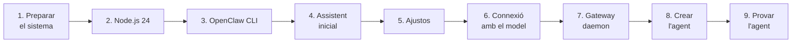

# Orquestració d'agents amb OpenClaw

## Què és OpenClaw?

**OpenClaw** és un agent d'IA de codi obert i autoallotjat que s'executa en una infraestructura local en lloc d'un servei al núvol gestionat.

Aquest enfocament autoallotjat és fonamental, especialment si fem servir un assistent d'IA que pot interactuar directament amb els nostres fitxers, processos i entorn operatiu: mantenim el control sobre on resideixen les dades.

{ width=180 loading=lazy }

## L'arquitectura del Gateway

Tot flueix a través d'un únic dimoni anomenat **Gateway**. Es manté en execució en segon pla, manté obertes les connexions de missatgeria i coordina l'agent d'IA. Aquesta és la seqüència quan envies un missatge:

1. El teu text arriba a través de WhatsApp, Telegram, Discord o la CLI.
2. El Gateway el passa a un agent de programació integrat anomenat ***Pi***, que pot executar ordres *shell* en nom nostre.
3. *Pi* envia la indicació (*prompt*) al nostre proveïdor de models.
4. El model respon amb instruccions que *Pi* executa localment.
5. Els resultats de l'execució tornen a través del Gateway cap al nostre xat.



### El Gateway

El **Gateway** és el procés central i el pla de control local (*control plane*) d'OpenClaw. Funciona com la font principal d'informació i l'orquestrador de tot el sistema. Les seves funcions són:

- Connectar l'assistent amb les diferents plataformes de missatgeria (Telegram, WhatsApp, Discord, Slack, etc.).
- Rebre els missatges entrants, gestionar les sessions dels usuaris i mantenir el context.
- Executar les crides als proveïdors de models de llenguatge (LLM) i invocar les eines i *plugins* necessaris.

## Configuració en un sistema Ubuntu

La configuració d'OpenClaw i d'un agent des de zero es fa mitjançant la seva interfície de línia d'ordres (`openclaw` CLI) i el fitxer de configuració central. El procés complet té aquestes fases:



### 1. Preparació del sistema

Actualitzem la llista de paquets i el sistema, i instal·lem les eines bàsiques:

```bash
sudo apt update && sudo apt upgrade -y
sudo apt install -y curl git build-essential
```

| Paquet | Per a què el necessitem |
|--------|-------------------------|
| `curl` | Descarregar l'script d'instal·lació de Node.js i provar l'API del model des del terminal. |
| `git` | Molts paquets npm i *plugins* es descarreguen des de repositoris Git. |
| `build-essential` | Compiladors (`gcc`, `make`…) necessaris per a les dependències de npm que inclouen mòduls natius. |

### 2. Instal·lació de Node.js 24 LTS

OpenClaw és una aplicació de Node.js i **necessita la versió 24 o superior**. Els repositoris oficials d'Ubuntu solen portar versions més antigues, per això fem servir el repositori de **NodeSource**:

```bash
curl -fsSL https://deb.nodesource.com/setup_24.x | sudo -E bash -
sudo apt install -y nodejs
```

- La primera ordre descarrega i executa l'script que afegeix el repositori de NodeSource al sistema. L'opció `-E` de `sudo` conserva les variables d'entorn de l'usuari (útil, per exemple, si hi ha un *proxy* configurat).
- La segona instal·la Node.js i `npm` (el gestor de paquets) des d'aquest repositori.

Comprovem la instal·lació:

```bash
node -v   # Ha de retornar v24.16.0 o superior
npm -v
```

!!! warning
    Si `node -v` retorna una versió inferior a la 24, OpenClaw no funcionarà correctament. Reviseu que no hi hagi una instal·lació antiga de Node.js que tingui prioritat.

### 3. Instal·lació d'OpenClaw CLI

Instal·lem OpenClaw de manera global, perquè l'ordre `openclaw` estigui disponible per a tot el sistema, i executem el procés d'incorporació (*onboarding*), que instal·la també el servei del Gateway:

```bash
sudo npm install -g openclaw@latest
openclaw onboard --install-daemon
```

### 4. Assistent inicial de configuració

Executem l'assistent que prepara el *workspace* i la configuració inicial:

```bash
openclaw setup
```

- Prepara l'estructura de carpetes, els arxius d'inicialització i l'entorn operatiu on treballa l'agent.
- Permet definir i modificar opcions tècniques del procés central del Gateway, paràmetres d'autenticació i claus de proveïdor.

Durant les preguntes interactives, responem:

| Pregunta | Resposta | Motiu |
|----------|:--------:|-------|
| *Enable systemd lingering?* | **Yes** | Permet que el servei romangui actiu sense cap sessió SSH oberta. Sense *lingering*, `systemd` atura els serveis de l'usuari quan aquest tanca la sessió. |
| *Disable unavailable skills?* | **Yes** | Evita avisos innecessaris per dependències absents. |
| *Enable bash shell completion?* | **Yes** | Afegeix l'autocompletat de les ordres d'`openclaw` amb la tecla <kbd>Tab</kbd>. |

### 5. Ajustos de configuració

Per defecte, OpenClaw té activada una **cerca semàntica a la memòria** que està configurada per fer servir els serveis d'OpenAI. Com que treballarem amb un model propi, la desactivem perquè processi únicament els missatges de la sessió activa:

```bash
openclaw config set memory.search.enabled false
```

**(Opcional)** Els models locals o remots en servidors petits poden trigar a carregar-se o a respondre. Per evitar que l'agent doni error per temps d'espera, podem ampliar el límit a 300 segons:

```bash
openclaw config set agents.defaults.timeoutSeconds 300
```

### 6. Connexió amb el model d'Ollama

Ara connectarem OpenClaw amb un model d'**Ollama** allotjat en un servidor de la xarxa de l'institut.

!!! info "Protocol `openai-completions`"
    OpenClaw utilitza el protocol **`openai-completions`** per consumir *endpoints* compatibles amb l'API d'OpenAI. Ollama ofereix aquesta API compatible a la ruta `/v1`, i en el nostre escenari està publicada darrere d'un servidor intermediari (**Nginx**), que és qui exigeix el *token* d'autenticació.

#### 6.1. Verificació de la connexió

Abans de tocar la configuració, comprovem des del terminal que arribem al servidor i que el *token* és vàlid:

```bash
curl -i http://IP_SERVIDOR/v1/models \
   -H "Authorization: Bearer TOKEN_1"
```

- `-i` mostra també les capçaleres de la resposta, cosa que ens permet veure el codi d'estat HTTP.
- La capçalera `Authorization: Bearer …` envia el *token* d'accés al servidor.

| Resposta | Significat |
|----------|------------|
| `200 OK` i un JSON amb la llista de models | La connexió i el *token* són correctes. |
| `401 Unauthorized` / `403 Forbidden` | El *token* no és vàlid o no s'ha enviat bé. |
| Sense resposta / *connection refused* | IP incorrecta, servidor aturat o problema de xarxa. |

#### 6.2. Configuració del proveïdor

Editem el fitxer de configuració principal d'OpenClaw:

```bash
nano ~/.openclaw/openclaw.json
```

Aquest és el fitxer central de la configuració d'OpenClaw. S'hi defineixen:

| Secció | Contingut |
|--------|-----------|
| `models` / `providers` | Proveïdors de models i claus API. |
| `channels` | Canals de missatgeria. |
| `messages` / `agents` | Comportament de l'agent i dels missatges. |
| — | Memòria, eines i *plugins*. |
| — | Ajustos del Gateway i de xarxa. |

Hi afegim el bloc `"models"` mantenint l'estructura vàlida del document JSON:

```json title="~/.openclaw/openclaw.json (fragment)"
"models": {
  "providers": {
    "ollama-remoto": {
      "api": "openai-completions",
      "baseUrl": "http://IP_SERVIDOR/v1",
      "apiKey": "TOKEN_1",
      "models": [
        {
          "id": "qwen2.5-coder:7b",
          "name": "qwen2.5-coder:7b"
        }
      ]
    }
  }
}
```

| Camp | Descripció |
|------|------------|
| `ollama-remoto` | Nom que donem al proveïdor. El farem servir després per referenciar el model (`ollama-remoto/qwen2.5-coder:7b`). |
| `api` | Protocol de comunicació: `openai-completions`. |
| `baseUrl` | Adreça base de l'API compatible amb OpenAI (acaba en `/v1`). |
| `apiKey` | *Token* d'accés que valida el servidor intermediari. |
| `models` | Llista de models disponibles al proveïdor: `id` és el nom exacte del model a Ollama i `name` el nom que es mostrarà. |

!!! warning "JSON vàlid"
    El bloc s'ha d'afegir **dins de l'objecte arrel** del fitxer. Recordeu posar una coma `,` després de l'element anterior i no deixar cap coma sobrant al final. Un sol error de sintaxi impedirà que OpenClaw arrenqui.

!!! danger "Claus i credencials"
    Substituïu `IP_SERVIDOR` i `TOKEN_1` pels valors que us doni el professor. No publiqueu mai la clau real en repositoris, captures o documents de lliurament.

#### 6.3. Validació

Validem la sintaxi del fitxer i comprovem l'estat del model:

```bash
openclaw config validate
openclaw models status
```

A la sortida ha d'aparèixer `ollama-remoto` amb el model detectat i la clau assignada.

### 7. Gateway com a servei (*daemon*)

Configurem el Gateway perquè s'executi com a servei en segon pla (*background service*) i el reiniciem perquè carregui la configuració nova:

```bash
openclaw daemon install
openclaw daemon restart
```

!!! info
    Així l'assistent funciona contínuament sense dependre de tenir una finestra de terminal oberta, i es reinicia automàticament si cal. Cada vegada que modifiqueu `openclaw.json`, cal reiniciar el *daemon* perquè s'apliquin els canvis.

### 8. Creació de l'agent

Finalment, creem l'agent i li donem permisos per executar accions reals al sistema. Perquè l'agent pugui llançar ordres al terminal de la màquina *host*, cal:

1. **Concedir-li permisos d'execució** d'eines.
2. **Instruir-lo** al seu fitxer de comportament (*prompt* del sistema).

#### 8.1. Permisos d'execució

Habilitem els permisos d'execució d'eines:

```bash
openclaw exec-policy set --allow-all
```

!!! danger "Només en exercicis de classe"
    `--allow-all` permet a l'agent executar **qualsevol ordre** al sistema. En un entorn real, l'agent s'hauria d'executar dins d'un ***sandbox*** o un contenidor **Docker** per protegir el *host*, aplicant el **principi de mínim privilegi**: concedir només els permisos estrictament necessaris per a la tasca.

#### 8.2. Directori de treball

Creem el directori de treball (*workspace*) de l'agent:

```bash
mkdir -p ~/.openclaw/workspace-sysadmin
```

#### 8.3. Personalitat i *prompt* del sistema

El fitxer `SOUL.md` defineix la personalitat de l'agent: és el seu ***prompt* del sistema**. Hi apliquem les tècniques vistes a [Estratègia de prompting](05-estrategia-prompting.md): rol, instruccions i format de sortida.

```bash
cat << 'EOF' > ~/.openclaw/workspace-sysadmin/SOUL.md
You are "SysAdmin", an agent with direct terminal access to this Ubuntu 24.04 server.

Guidelines:
1. When the user asks for system information or diagnostics, directly execute the necessary bash command using your execution tool.
2. After executing the command, briefly summarize the output in Catalan.
3. Be concise, technical, and precise.
EOF
```

!!! tip "Què fa `cat << 'EOF'`?"
    És un *heredoc*: escriu al fitxer tot el text que hi ha fins a la línia `EOF`. Posar `'EOF'` entre cometes evita que el *shell* interpreti variables o caràcters especials del text.

| Línia del *prompt* | Component |
|--------------------|-----------|
| *You are "SysAdmin", an agent with direct terminal access…* | **Rol** i context |
| *Directly execute the necessary bash command…* | **Instruccions** |
| *Briefly summarize the output in Catalan.* | **Format de la resposta** |
| *Be concise, technical, and precise.* | **To** |

#### 8.4. Registre de l'agent

Registrem l'agent a OpenClaw, indicant-ne el *workspace* i el model que farà servir:

```bash
openclaw agents add sysadmin --workspace ~/.openclaw/workspace-sysadmin --model ollama-remoto/qwen2.5-coder:7b
```

- `sysadmin`: nom de l'agent.
- `--workspace`: directori on hi ha el `SOUL.md` i on treballarà l'agent.
- `--model`: model en format `proveïdor/model`, tal com l'hem definit a `openclaw.json`.

### 9. Prova de l'agent

Executem una acció i comprovem que l'agent funciona:

```bash
openclaw agent --agent sysadmin --message "Check how much disk space is left and summarize it"
```

Si tot és correcte, l'agent executarà una ordre com `df -h`, i en retornarà un resum en català de l'espai disponible.

??? question "L'agent no respon o dona error?"
    - Comproveu de nou la connexió amb el servidor (`curl`, [apartat 6.1](#61-verificacio-de-la-connexio)).
    - Valideu el fitxer de configuració (`openclaw config validate`).
    - Reinicieu el *daemon* (`openclaw daemon restart`).
    - Si el model triga molt a respondre, amplieu el temps d'espera ([apartat 5](#5-ajustos-de-configuracio)).


## Per saber-ne més

- [**Getting started**](https://docs.openclaw.ai/start/getting-started){ target="_blank" rel="noopener" } · *Documentació d'OpenClaw*  
  Guia ràpida oficial: instal·lació, configuració inicial i primer missatge a l'agent.
- [**Gateway configuration**](https://docs.openclaw.ai/gateway/configuration){ target="_blank" rel="noopener" } · *Documentació d'OpenClaw*  
  Referència completa del fitxer de configuració del Gateway.
- [**Security**](https://docs.openclaw.ai/gateway/security){ target="_blank" rel="noopener" } · *Documentació d'OpenClaw*  
  Model de confiança, valors per defecte i recomanacions per enfortir el Gateway.
- [**LLM06:2025 Excessive Agency**](https://genai.owasp.org/llmrisk/llm062025-excessive-agency/){ target="_blank" rel="noopener" } · *OWASP*  
  Riscos de donar massa permisos o autonomia a un agent i com limitar-los.
