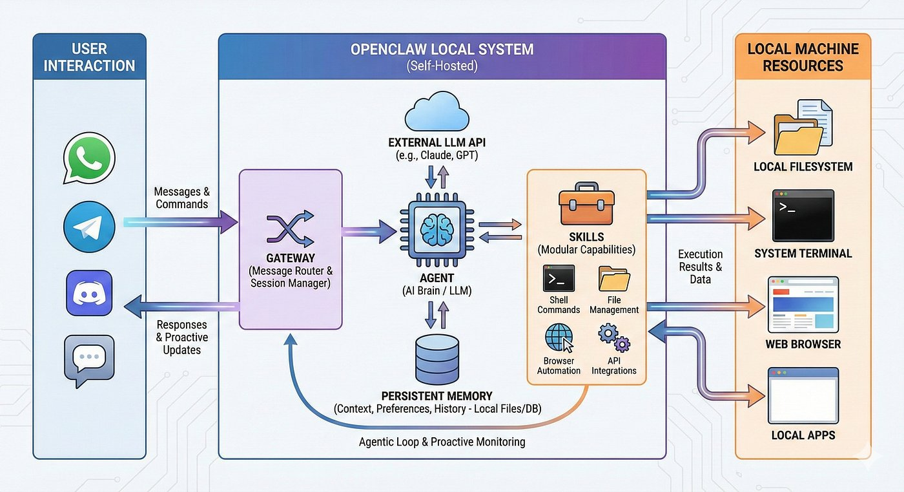

# Orquestració d'agents amb OpenClaw

## Què és OpenClaw?

**OpenClaw** és un agent d'IA de codi obert i autoallotjat que s'executa en una infraestructura local en lloc d'un servei al núvol gestionat.

Aquest enfocament autoallotjat és fonamental, especialment si fem servir un assistent d'IA que pot interactuar directament amb els nostres fitxers, processos i entorn operatiu: mantenim el control sobre on resideixen les dades.

{ width=180 loading=lazy }

## L'arquitectura del Gateway

Tot flueix a través d'un únic dimoni anomenat **Gateway**. Es manté en execució en segon pla, manté obertes les connexions de missatgeria i coordina l'agent d'IA. Aquesta és la seqüència quan envies un missatge:

1. El teu text arriba a través de WhatsApp, Telegram, Discord o la CLI.
2. El Gateway el passa a un agent de programació integrat anomenat *Pi*, que pot executar ordres *shell* en nom nostre.
3. *Pi* envia la instrucció (*prompt*) al nostre proveïdor de models.
4. El model respon amb instruccions que *Pi* executa localment.
5. Els resultats de l'execució tornen a través del Gateway cap al nostre xat.

{ loading=lazy }

### Funcions del Gateway

El **Gateway** és el procés central i el pla de control local (*control plane*) d'OpenClaw. Funciona com la font principal d'informació i l'orquestrador de tot el sistema. Les seves funcions inclouen:

- Connectar l'assistent amb les diferents plataformes de missatgeria (Telegram, WhatsApp, Discord, Slack, etc.).
- Rebre els missatges entrants, gestionar les sessions dels usuaris i mantenir el context.
- Executar les crides als proveïdors de models de llenguatge (LLM) i invocar les eines i *plugins* necessaris.

## Configuració en un sistema Ubuntu

Per configurar OpenClaw i un agent des de zero en Ubuntu, la gestió es fa mitjançant la interfície de línia d'ordres (`openclaw` CLI) i el fitxer de configuració central.

### 1. Instal·lació

Instal·lem les dependències necessàries i OpenClaw:

```bash
sudo npm install -g openclaw@latest
```

### 2. Preparació del *workspace*

Executem l'ordre que permet gestionar la configuració del sistema i crear i configurar el *workspace*:

```bash
openclaw setup
```

- Prepara l'estructura de carpetes, els fitxers d'inicialització i l'entorn on treballa l'agent.
- Permet definir i modificar opcions tècniques del Gateway, paràmetres d'autenticació i claus de proveïdor.

### 3. Ajustos recomanats

Desactivem la cerca semàntica perquè processi únicament els missatges de la sessió activa:

```bash
openclaw config set memory.search.enabled false
```

Opcionalment, podem ampliar el límit a 300 segons per permetre que el model carregui (no serà necessari per al model de la pràctica):

```bash
openclaw config set agents.defaults.timeoutSeconds 300
```

### 4. Fitxer de configuració principal

És el fitxer central de la configuració d'OpenClaw, `~/.openclaw/openclaw.json` (en format JSON5). S'hi defineix:

- Proveïdors de models i claus API (`providers`).
- Canals de missatgeria (`channels`).
- Comportament de l'agent i missatges (`messages` / `agents`).
- Memòria, eines i *plugins*.
- Ajustos del Gateway i de xarxa.

### 5. Gateway com a servei

És important configurar el Gateway perquè s'executi com a servei en segon pla (*background service*):

```bash
openclaw daemon install
openclaw daemon restart
```

> [!NOTE]
> Així l'assistent funciona contínuament sense dependre de tenir una finestra de terminal oberta, i es reinicia automàticament si cal.

## Per saber-ne més

- [**Getting started**](https://docs.openclaw.ai/start/getting-started){ target="_blank" rel="noopener" } · *Documentació d'OpenClaw*  
  Guia ràpida oficial: instal·lació, configuració inicial i primer missatge a l'agent.
- [**Gateway configuration**](https://docs.openclaw.ai/gateway/configuration){ target="_blank" rel="noopener" } · *Documentació d'OpenClaw*  
  Referència completa del fitxer de configuració del Gateway.
- [**Security**](https://docs.openclaw.ai/gateway/security){ target="_blank" rel="noopener" } · *Documentació d'OpenClaw*  
  Model de confiança, valors per defecte i recomanacions per enfortir el Gateway.
- [**LLM06:2025 Excessive Agency**](https://genai.owasp.org/llmrisk/llm062025-excessive-agency/){ target="_blank" rel="noopener" } · *OWASP*  
  Riscos de donar massa permisos o autonomia a un agent i com limitar-los.
