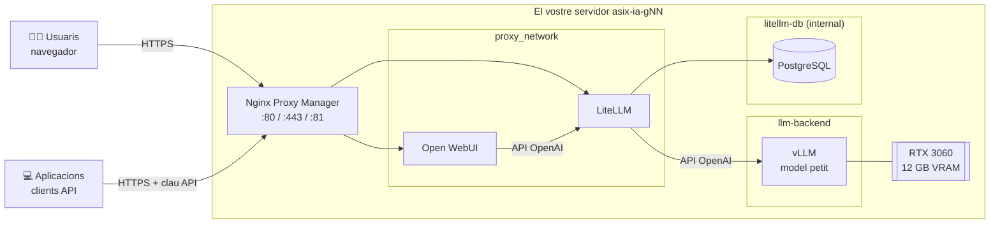

# Desplegament - L'arquitectura que construirem

## La plataforma en una imatge

## Què fa cada peça

| Servei | Funció | Equivalent «clàssic» |
|---|---|---|
| **vLLM** | Carrega el model a la GPU i respon peticions amb una API compatible OpenAI | El servidor de bases de dades: el motor |
| **LiteLLM** | Passarel·la: claus per usuari, àlies de models, límits i registre de consum | Un *API gateway* |
| **PostgreSQL** | Guarda les claus i el consum de LiteLLM | La BD de l'aplicació |
| **Open WebUI** | Interfície de xat per als usuaris | L'aplicació web |
| **Nginx Proxy Manager** | Única porta d'entrada: proxy invers i certificats TLS | El proxy invers |

Cada bloc és un **stack de Docker Compose** independent.

## Les quatre decisions de disseny

Això és el que heu d'entendre. La resta són detalls d'implementació.

1. **Una sola porta d'entrada.** Només Nginx Proxy Manager publica ports al servidor (80, 443 i 81). Cap altre servei és accessible des de fora: ni vLLM, ni LiteLLM, ni la base de dades.
2. **Ningú parla directament amb el model.** Tant el xat com les aplicacions passen per LiteLLM, que comprova la clau, aplica límits i apunta el consum. Si demà canviem el model, els clients no se n'assabenten.
3. **Xarxes separades segons qui ha de parlar amb qui.** Cada servei només és a les xarxes que necessita. La base de dades és en una xarxa `internal`, sense sortida a Internet i on només hi ha LiteLLM.
4. **Les dades importants viuen en volums.** Els contenidors es poden esborrar i tornar a crear en qualsevol moment; els volums no. Cal saber quins són crítics (usuaris, converses, claus) i quins es poden regenerar (pesos del model, memòria cau).
